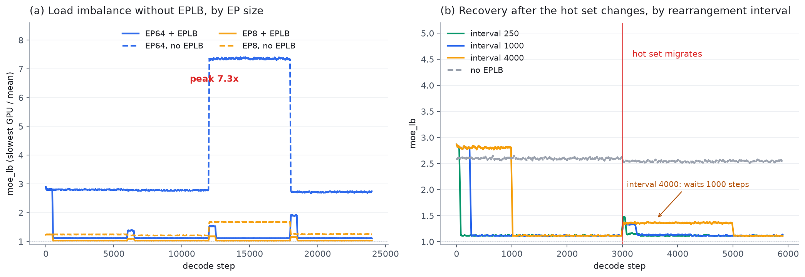
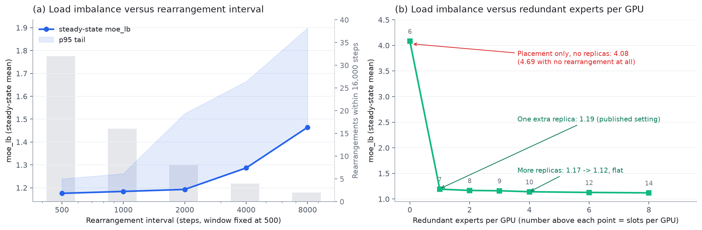

# Reproducing DeepInfer's EPLB in NumPy

This repository reimplements the expert-parallel load balancer used in DeepInfer
and runs it against synthetic traffic. The aim is to measure how each part of the
upstream design contributes to load balance, since the deployment
documentation describes the mechanism but does not separate the effects.

The companion note on DeepInfer's architecture is at
[deepinfer-notes](https://github.com/demianemilesinclair/deepinfer-notes).

## 1. Questions the documentation leaves open

The upstream deployment Q&A gives the mechanism, the parameters and the measured
`moe_lb` values. It does not say:

1. how much redundancy and rearrangement contribute separately;
2. whether the published parameters follow from the mechanics or from tuning;
3. whether the conclusions hold for different traffic.

A simulator can answer the first and third. The second is partly answerable by
sweeping the parameters.

## 2. Implementation

### 2.1 Terms

Four quantities describe the layout:

- `logical`: routed experts defined by the model, 384 for V4.1;
- `extra`: redundant replicas added on top;
- `physical`: weight rows allocated, equal to `logical + extra`, and divisible
  by the EP size;
- `capacity`: physical experts per GPU, equal to `physical / EP`.

`capacity` sets the granularity of any balancing scheme. At EP64 it is 7, so a
single hot expert can determine whether a GPU is saturated. At EP8 it is 52, and
per-expert variation averages out.

The divisibility constraint exists because all-to-all dispatch needs the same
slot count on every GPU. The upstream helper that enforces it is:

```python
def resolve_num_extra_experts(num_routed_experts, min_num_extra_experts, ep_size):
    padding = -(num_routed_experts + min_num_extra_experts) % ep_size
    return min_num_extra_experts + padding
```

### 2.2 Allocating replicas

`rebalance_experts_global` adds replicas one at a time. Each round selects the
expert whose additional copy reduces the maximum per-replica load the most.

```python
tokens_diff = tokens_per_expert + arange_logical * 1e-4   # break ties
for i in range(num_redundant):
    score = tokens_diff / logical_count[None, :, :]
    score_added = tokens_per_expert / (logical_count + 1)[None, :, :]

    argmax_idx = score.argmax(axis=-1, keepdims=True)
    values = np.broadcast_to(np.take_along_axis(score, argmax_idx, -1), score.shape).copy()
    np.put_along_axis(values, argmax_idx, np.take_along_axis(score_added, argmax_idx, -1), -1)

    redundancy_indices = values.sum(axis=0).argmin(axis=-1)
```

`values` holds the maximum per-replica load at each historical step under the
candidate assignment. Taking the argmin over the sum across steps selects the
expert for this round.

The `1e-4` offset breaks ties deterministically. Upstream notes that the scores
must be distinct, and a small separable bias is cheaper than an explicit
tie-break branch.

The objective is computed per layer. Hot experts in layer 3 and layer 40 are
independent, and each layer gets its own replication plan.

### 2.3 Placing replicas

With the replication plan fixed, `_batch_greedy_indices` chooses which GPU holds
which replica. Its objective is the sum over steps of the maximum rank load, not
the mean, because each decode step is limited by the slowest GPU.

```python
candidates = np.maximum(loads + vector[:, None, :], peaks[:, None, :])
scores = candidates.sum(axis=-1)
scores = np.where(occupancy == capacity, np.inf, scores)
rank = scores.argmin(axis=-1)
```

Ranks that already hold `capacity` experts are masked out, since the slot count
per GPU is fixed.

The prediction assumes replicas of an expert split its load evenly, so a replica
carries `logical load / replica count`. Upstream's `_log_rearrangement_metrics`
uses the same convention. Whether actual dispatch is even depends on the router,
but the planner needs a defined quantity.

### 2.4 Simulation loop

```python
for t, counts in enumerate(traffic):
    lb[t] = step_metrics(counts, state)         # measure with the current layout
    state.window[state.window_index] = counts   # write into the ring buffer
    state.window_index = (state.window_index + 1) % window
    steps_since += 1
    if steps_since >= interval:
        steps_since = 0
        state.mapping = rebalance(state.window)  # applies from the next step
```

Three details follow upstream:

- rearrangement uses the most recent `window` steps, not all history;
- the new layout applies to the next step, so the current step is still measured
  with the old layout;
- the first rearrangement happens at one quarter of the interval. At cold start
  the statistics are empty, so waiting a full period leaves the initial skew in
  place longer than necessary.

## 3. Verification

`tests/test_policy.py` checks four properties.

1. Structural invariants: every logical expert has at least one replica, every
   GPU holds exactly `capacity` slots, and `physical -> logical` and
   `logical -> physical` are inverses.
2. Over 200 random placements, none produces a lower objective than the greedy.
3. With uniform load, the result is exactly balanced. This is the only case with
   a known optimum.
4. On a 4-expert, 6-slot instance, every replication plan and every placement is
   enumerated. The greedy is 0.40% off optimal on average and 2.37% in the worst
   case.

The fourth check bounds how much the greedy gives up. On this problem the gap to
an exhaustive search is small.

One implementation error is worth recording. The first version of the brute-force
check omitted the division of replica load by replica count, so the greedy
appeared to beat the optimum. The test was wrong, not the implementation.

## 4. Experiments

Traffic model: 384 experts, 4 layers, 512 tokens per step with top-8 routing,
power-law popularity, and a new hot set every 6000 steps. The baseline runs
24,000 steps; the sweeps run 16,000.



### 4.1 Baseline

| Configuration | Mean | p50 | p95 | Max |
|---|---|---|---|---|
| EP8, no EPLB | 1.32 | 1.23 | 1.63 | 1.70 |
| EP8 with EPLB | 1.04 | 1.03 | 1.11 | 1.24 |
| EP64, no EPLB | 3.90 | 2.63 | 7.46 | 7.85 |
| EP64 with EPLB | 1.15 | 1.11 | 1.42 | 2.11 |

At EP64 without balancing, the mean is 3.9 and the 95th percentile is 7.5. The
slowest GPU carries several times the average load.

The difference between EP8 and EP64 is larger than per-expert noise explains. It
follows from `capacity`: 52 slots per GPU at EP8 against 6 at EP64.

Panel (a) of the figure also shows the effect of traffic drift. Without
rearrangement, the EP64 curve sits near 2.8 for the first 12,000 steps, rises to
7.3 between 12,000 and 18,000, then returns to 2.8. The hot set changed at
12,000, and the fixed layout handled it less well. A static layout produces
results that depend on which experts happen to be hot.

### 4.2 Placement without redundancy

With rearrangement allowed but no redundant experts (`extra = 0`), EP64 reaches
4.08, against 4.69 with no rearrangement at all.

The limit here is arithmetic. The hottest expert carries 3.9% of all tokens,
while the average GPU at EP64 carries 1/64, or 1.56%. Its GPU therefore carries
at least 3.9% x 64, about 2.5 times the mean, and every GPU still has to hold six
experts, so a result in the 3 to 4 range is close to the achievable floor.

Replicas divide a hot expert across GPUs. Placement only decides where the
replicas go. This is consistent with the published configuration, which never
uses `extra = 0`.

A related measurement: adding replicas without rearrangement is slightly worse
than adding none (EP64: 4.04 against 3.90). The initial layout is sequential, so
copies are placed next to experts that do not need them.

### 4.3 Number of replicas



| Redundant per GPU | Slots per GPU | Steady-state moe_lb |
|---|---|---|
| 0 | 6 | 4.08 |
| 1 | 7 | 1.19 |
| 2 | 8 | 1.17 |
| 3 | 9 | 1.16 |
| 4 | 10 | 1.14 |
| 6 | 12 | 1.13 |
| 8 | 14 | 1.12 |

The change from 0 to 1 accounts for most of the improvement. Further replicas
reduce the metric by a further 0.07 at most. The published choice of one
redundant expert per GPU for decode sits near this point.

For prefill, `capacity` is larger (48 to 52), so the marginal value of a replica
is lower, and four replicas per GPU cost roughly 8% more expert memory.

### 4.4 Rearrangement interval

With the window fixed at 500 and only the interval varying:

| Interval | Mean | p95 | Rearrangements in 16,000 steps |
|---|---|---|---|
| 500 | 1.176 | 1.24 | 32 |
| 1000 | 1.184 | 1.26 | 16 |
| 2000 | 1.193 | 1.52 | 8 |
| 4000 | 1.287 | 1.66 | 4 |
| 8000 | 1.465 | 1.90 | 2 |

The mean degrades slowly with the interval, but the 95th percentile increases
from 1.26 to 1.52 when the interval goes from 1000 to 2000 steps. The mean
reports typical behaviour; the tail reports the cost when the layout is stale.

The cost of rearranging is not CPU time. At this scale one greedy rearrangement
takes 200 to 300 ms, which is small compared with moving expert weights. Weight
shuffling between GPUs is network traffic and has to complete without
interrupting inference, which is why the decode interval is set to 10,000 steps.

### 4.5 Traffic shift

One migration at step 3000, averaged over the following 3000 steps:

| Configuration | Mean moe_lb after the shift |
|---|---|
| No EPLB | 2.54 |
| Interval 4000 | 1.28 |
| Interval 1000 | 1.14 |
| Interval 250 | 1.13 |

The 4000-step curve stays near 1.4 for about 1000 steps, then drops to 1.1. A
rearrangement is a discrete event, so recovery happens at the next rearrangement
rather than continuously.

## 5. Comparison with the published configuration

| Published choice | Measurement |
|---|---|
| Decode: 1 redundant expert per GPU | The change from 0 to 1 gives 4.08 to 1.19; further replicas add at most 0.07 |
| Prefill: 4 redundant experts per GPU | Larger `capacity`; replicas are cheap and marginal |
| Decode: window 1000, interval 10,000 | Longer intervals raise the tail but reduce weight movement |
| Prefill: window 100, interval 1000 | Fewer steps and faster-changing traffic |
| First rearrangement at a quarter of the interval | Reduces cold-start skew |

One production figure cannot be tested here. The documentation states that
deployment reaches about 80% of a perfectly balanced offline benchmark. The
simulation reaches 1.15 against a floor of 1.00, but it does not separate
rearrangement lag from request long tails. Simulation gives the mechanism, not
the absolute value.

## 6. Limitations

- Traffic is synthetic. Absolute numbers are not comparable to the 1.09 measured
  in production; only relative comparisons between strategies are meaningful.
- All-to-all communication, weight shuffling and GPU timing are not modelled.
- Layers are balanced independently, while the metric sums across layers per GPU,
  matching the upstream convention.

## 7. Running the code

```bash
python -m pip install numpy
python experiments/run_all.py    # about 3 minutes
python experiments/make_figs.py
python tests/test_policy.py
```

`eplb/policy.py` is a port of a DeepInfer algorithm under Apache-2.0; the scope
is described in [THIRD_PARTY.md](THIRD_PARTY.md).

Simulation parameters: 384 experts, 4 layers, 512 tokens per step with top-8
routing, 24,000 steps, seed 42.
